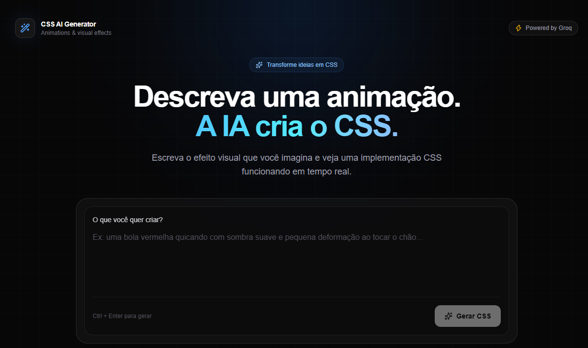

<div align="center">

# 🎨 CSS AI Generator

<p><em>Transforme descrições em animações CSS com a ajuda da inteligência artificial.</em></p>

[](https://nextjs.org/)
[](https://react.dev/)
[](https://www.typescriptlang.org/)
[](https://tailwindcss.com/)
[](https://console.groq.com/docs)

</div>

Descreva o efeito que você imaginou e receba CSS para experimentar na hora. Explore a prévia, refine o resultado com novas instruções e copie ou baixe o código para usar no seu projeto.

<p align="center">
  
</p>

## ✨ Funcionalidades

- 🧠 **Geração com IA:** crie animações CSS descrevendo o efeito em português ou inglês.
- 🛠️ **Refinamento por instruções:** ajuste o CSS gerado pedindo mudanças em linguagem natural.
- 👁️ **Prévia interativa:** pause, retome ou reinicie a animação enquanto ajusta o resultado.
- 🎨 **Fundos para visualização:** alterne o fundo da prévia para conferir melhor cores e transparências.
- 📋 **Copiar e baixar:** copie o CSS ou salve o resultado em um arquivo `.css`.
- 🕘 **Histórico local:** recupere os últimos designs salvos neste navegador.
- 🧊 **Elementos especiais:** visualize composições como cubos 3D e elementos com texto.

## 🚀 Tecnologias

| Tecnologia | Uso |
| --- | --- |
| [Next.js](https://nextjs.org/) | Aplicação web e rota de API |
| [React](https://react.dev/) | Interface interativa |
| [TypeScript](https://www.typescriptlang.org/) | Tipagem do projeto |
| [Tailwind CSS](https://tailwindcss.com/) | Estilos da interface |
| [Groq API](https://console.groq.com/docs) | Geração e refinamento do CSS |

## 📋 Pré-requisitos

- [Node.js](https://nodejs.org/) compatível com a versão do Next.js usada pelo projeto.
- npm.
- Uma chave de API da [Groq](https://console.groq.com/keys).

## 🔧 Como executar localmente

1. Abra um terminal na pasta do projeto e instale as dependências:

   ```bash
   npm install
   ```

2. Crie `.env.local` na raiz do projeto e configure sua chave da Groq:

   ```env
   GROQ_API_KEY=gsk_sua_chave_aqui
   ```

   O valor acima é apenas um exemplo. Crie sua chave em [console.groq.com/keys](https://console.groq.com/keys), mantenha-a privada e nunca a envie para o GitHub.

3. Inicie o servidor de desenvolvimento:

   ```bash
   npm run dev
   ```

4. Abra [http://localhost:3000](http://localhost:3000) no navegador.

## Publicação em produção

O arquivo `.env.local` é usado apenas no ambiente local e não é enviado ao Git. Para habilitar a geração de CSS em produção, cadastre `GROQ_API_KEY` nas variáveis de ambiente do provedor de hospedagem, com o valor da sua chave da Groq, habilite-a para o ambiente de produção e faça um novo deploy. Não coloque a chave em arquivos públicos nem em variáveis com prefixo `NEXT_PUBLIC_`.

Se a rota `/generate` responder que `GROQ_API_KEY` não está configurada, confira se a variável foi cadastrada no projeto e no ambiente corretos e se o último deploy foi feito depois dessa configuração.

## 📜 Scripts disponíveis

| Comando | Descrição |
| --- | --- |
| `npm run dev` | Inicia o servidor de desenvolvimento. |
| `npm run lint` | Verifica o código com ESLint. |
| `npm run build` | Cria a versão de produção. |
| `npm start` | Executa a versão de produção após o build. |

## 🗂️ Estrutura do projeto

```text
app/
├── generate/route.ts  # Integração com a API da Groq
├── globals.css        # Estilos globais
├── layout.tsx         # Layout principal
└── page.tsx           # Interface e prévia do gerador
public/
└── screenshot.png     # Captura de tela do projeto
```

## 👤 Autor

<div align="center">

**Alberto Luiz**

[](https://github.com/alberto2santos)
[](https://www.linkedin.com/in/alberto-luiz/)
[](mailto:alberto.dos.santos93@gmail.com)

</div>
